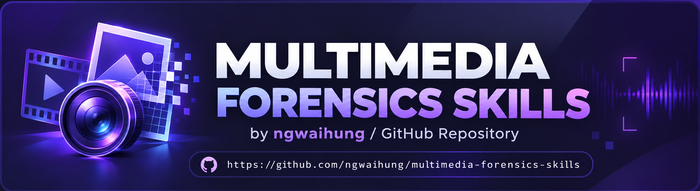

<p align="center">
  
</p>

<div align="center">

# Multimedia Forensics Skills
[](LICENSE)
[](CONTRIBUTING.md)

</div>

### This skills suite for LLMs is first presented at the 37th Annual LEVA Training Symposium 2026 (Oct 26 - 30, 2026).

A suite of agent instructions for examining the authenticity and provenance of images, video, and audio. The skills are written for question-driven forensic work referencing SWGDE best practices for fundamental guidelines and procedures: preserve evidence, state competing explanations, choose tests that can distinguish them, document each operation, and report conclusions within the limits of the material and methods.

#### <b>Note</b>: These files guide an examiner; they do not run an examination or certify evidence for court. A court-facing opinion still needs competent human oversight, applicable laboratory procedures, method and tool validation, chain-of-custody records, and independent review where required.

Contributions from examiners, practitioners, researchers, and developers are welcome. See [CONTRIBUTING.md](CONTRIBUTING.md) for scope, quality, and pull request guidance.

## Single-file import

The root [skills.md](skills.md) is a **self-contained aggregate** of the suite for platforms that accept one Markdown skill file. Import that file as `multimedia-forensics-skills` to get one listing covering triage, image/video/audio authentication, synthetic-media analysis, content provenance, enhancement, and reporting. Its evidence protocol, question-driven workflows, tool choices, cautions, and reporting rules work without access to the rest of this repository. The nine specialist directories below remain the maintainable, more detailed version; choose their references and workflows when the platform can access multiple files.

For **OpenClaw/ClawHub GitHub import**, the [skill-format documentation](https://docs.openclaw.ai/clawhub/skill-format) says the web importer discovers `SKILL.md` or legacy `skills.md` in eligible public repositories owned by the signed-in GitHub account. Select the root `skills.md` entry if you want this suite as one listing; nested `SKILL.md` files may also appear as separate entries. This is different from [native OpenClaw skill discovery](https://docs.openclaw.ai/tools/creating-skills), which uses a skill directory containing `SKILL.md`. For that route, package this aggregate as a directory named `multimedia-forensics-skills` and copy the root file to `multimedia-forensics-skills/SKILL.md`; then check discovery with `openclaw skills list`. The file in this repository is lowercase `skills.md` by design for the requested root-level import. Import behavior has not been tested in an OpenClaw instance here.

## Choose a skill

| Skill | Use it for |
| --- | --- |
| [`multimedia-authentication`](multimedia-authentication/SKILL.md) | Plan and coordinate an end-to-end examination across media types. |
| [`media-triage`](media-triage/SKILL.md) | Preserve, identify, inventory, and route submitted files. |
| [`image-authentication`](image-authentication/SKILL.md) | Test still-image manipulation, scene consistency, and source-camera propositions. |
| [`video-authentication`](video-authentication/SKILL.md) | Test video source, encoding history, continuity, timing, and visual edits. |
| [`audio-authentication`](audio-authentication/SKILL.md) | Test digital audio provenance, pauses, splices, and acoustic continuity. |
| [`synthetic-media-analysis`](synthetic-media-analysis/SKILL.md) | Assess generated or synthetically altered content using provenance and validated methods. |
| [`content-provenance`](content-provenance/SKILL.md) | Find other occurrences and assess publication lineage, metadata, C2PA claims, and producer watermarks. |
| [`forensic-enhancement`](forensic-enhancement/SKILL.md) | Create documented derivatives for inspection or measurement without treating generated detail as source evidence. |
| [`forensic-reporting`](forensic-reporting/SKILL.md) | Turn case records into reproducible findings and a reviewable report. |

## How the skills fit together

Start with `multimedia-authentication` for a broad request, or use `media-triage` when the files and their generation are unknown. The triage result leads to the relevant image, video, audio, or synthetic-media examination. Add `content-provenance` when other published copies, a claimed source, signed credentials, or watermarks could help test the proposition. Use `forensic-enhancement` only for a defined inspection or measurement need, then `forensic-reporting` to assemble the findings.

The specialist skills link to common methods, workflows, and the finding schema under `multimedia-authentication/`. Keep the **nine skill directories together as siblings** if installing or copying the suite; moving one folder alone will break its relative reference links. The main skill routes to specialists, but an agent should load only the references relevant to the current question. The skill files suggest tools and algorithms; the image skill bundles a supplementary Python metadata reader, while ExifTool, c2patool, models, and external services are not bundled or required for every case.

```text
.
├── README.md
├── skills.md                  # Self-contained single-file suite
├── multimedia-authentication/
│   ├── SKILL.md                 # Examination protocol and routing
│   ├── references/              # Evidence, modality, enhancement, and reporting methods
│   ├── workflows/               # Image manipulation, video continuity, audio splicing
│   └── schemas/
│       └── finding-schema.json  # Structured finding record
├── media-triage/
├── image-authentication/
├── video-authentication/
├── audio-authentication/
├── synthetic-media-analysis/
├── content-provenance/
├── forensic-enhancement/
└── forensic-reporting/
    └── SKILL.md                 # Each specialist directory has a SKILL.md
```

## Examination pattern

1. **Preserve and identify:** record the source, custody, byte count, SHA-256, file generation, and verified working copy.
2. **Define the question:** separate provenance, source device, content alteration, and the truth of depicted events; state alternatives before testing.
3. **Select and validate methods:** inspect relevant structure and content, use suitable exemplars or controls, and record tool versions, settings, errors, and uncertainty.
4. **Challenge findings:** test benign capture, export, and platform-processing explanations and seek independent corroboration.
5. **Report and review:** separate observations from interpretations, disclose contrary evidence and limits, and trace every exhibit to its source and derivative history. Mark an opinion preliminary until the applicable independent review and human authorization occur.

The [finding schema](multimedia-authentication/schemas/finding-schema.json) provides a consistent shape for individual results. Passing schema validation checks record structure; it does not validate a method or make a conclusion scientifically sound.

## Illustrative Comparison: Generic answer versus Skill-guided examination

These are **constructed examples of response style**. The skill-guided examples show the kind of case record and restraint this suite asks an agent to produce. Actual performance must be evaluated on known cases with the chosen model, tools, and examiner review.

### Image: “Was this shared photograph composited?”

Assume the only submission is a platform-downloaded JPEG with an apparently unusual shadow near one person.

> **Generic answer:** “The shadow looks inconsistent. The person was probably Photoshopped into the image.”

> **Skill-guided answer:** “The apparent shadow difference is an observation, not a splice finding. First preserve and hash the submitted JPEG, determine whether it is a camera original or platform export, and request an earlier version or related image series. Compare scene geometry and lighting with file structure, compression, and suitable control regions. Local illumination, HDR processing, and recompression remain alternative explanations. On the stated material, the manipulation proposition is unresolved.”

The [image skill](image-authentication/SKILL.md) directs the agent to report source generation, test settings, contrary evidence, and the limits of a single derivative image.

### Video: “Was time removed at 00:07?”

Assume a short clip has a visible jump near the displayed time of seven seconds.

> **Generic answer:** “There is a jump cut at 00:07, so part of the recording was deleted.”

> **Skill-guided answer:** “A visible transition near the player's 00:07 display does not establish missing captured time. Preserve the native container; map the interval to packet/frame indices and presentation timestamps; examine edit lists, frame durations, GOP behavior, and neighboring audio. Test camera pause, variable frame rate, dropped frames, and export behavior against an original or matched exemplar. Report separately whether a content cut, timing discontinuity, or deletion is supported.”

The [video skill](video-authentication/SKILL.md) makes the timeline reproducible and keeps the conclusion tied to the specific discontinuity established.

### Audio: “Does this pause prove a splice?”

Assume a recording contains a brief silence before the next speaker turn.

> **Generic answer:** “The silence and spectrogram break show that the audio was edited.”

> **Skill-guided answer:** “Mark the pause in source samples and time, retain the encoded original, and compare codec frames, waveform, noise floor, reverberation, and channels on both sides. Test voice activity detection, automatic gain, packet loss, and a natural conversational pause as alternatives. A spectrogram discontinuity can locate a candidate boundary; the cause remains undetermined until corroborated.”

The [audio skill](audio-authentication/SKILL.md) calls for global and local tests, controls, and uncertainty around any proposed boundary.

### Provenance: “Is this the first post, and is it AI-generated?”

Assume a social post has no EXIF metadata and a reverse-search service returns one older-looking result.

> **Generic answer:** “The missing EXIF suggests AI generation, and the oldest search result is the original source.”

> **Skill-guided answer:** “Missing EXIF is common after platform processing. Preserve the search query and result, retrieve and hash the candidate media, and compare distinctive content and transformations. Check other indexes and archived occurrences; distinguish earliest located from earliest documented publication and original capture. If present, validate C2PA content binding and signer trust; use an official producer watermark verifier only for its supported claim. Neither an absent credential nor a negative watermark check excludes synthesis.”

The [content-provenance](content-provenance/SKILL.md) and [synthetic-media](synthetic-media-analysis/SKILL.md) skills require the agent to separate publication history, signed claims, watermark coverage, and the truth of the depicted event.

Across these examples, the expected gain is a **testable, traceable preliminary finding**: identified evidence, rival explanations, appropriate methods, reproducible steps, and a conclusion bounded by what was actually measured. The suite cannot supply missing originals, validate a tool automatically, or replace independent qualified review.

## Guidance and tools

The procedures draw on applicable [SWGDE publications](https://www.swgde.org/documents/current-documents/), including [image authentication 18-I-001-2.0](https://www.swgde.org/wp-content/uploads/2025/03/2025-03-03-Best-Practices-for-Image-Authentication-18-I-001-2.0.pdf), [digital video authentication 23-V-001-1.2](https://www.swgde.org/wp-content/uploads/2026/02/23-V-001-1.2-Best-Practices-for-Digital-Video-Authentication.pdf), [digital audio authentication 15-A-001-1.3](https://www.swgde.org/documents/published-complete-listing/15-a-001-swgde-best-practices-for-digital-audio-authentication/), and [report writing 18-Q-002-1.0](https://www.swgde.org/documents/published-complete-listing/18-q-002-swgde-requirements-for-report-writing-in-digital-and-multimedia-forensics/). Check the current version and local SOP before case use. The video document linked above identifies itself as **version 1.2, dated 7 March 2024**, despite the `2026/02` URL path.

Suggested open source tools include ExifTool, MediaInfo, FFmpeg/FFprobe, OpenCV, Python signal and image libraries, and c2patool. Public reverse-search services, producer watermark verifiers, and research deepfake models have different coverage and disclosure requirements. A tool name in a skill is a candidate for a specific question, not an endorsement or a standing instruction to run it on every file. In particular, an absent anomaly, credential, or watermark does not prove authenticity.

## Use with different LLMs and agents

The `SKILL.md` format is a set of instructions and supporting files, not a model checkpoint. A model or chat interface can read the text, but it can perform an examination only if its **agent environment** can access the evidence, run validated tools, preserve outputs, and maintain a case log. Choose the deployment pattern that matches the interface:

| Environment | How to provide the suite |
| --- | --- |
| **Any single-file import or chat interface** | Supply the root [skills.md](skills.md) as one skill or attachment and ask the agent to follow `multimedia-forensics-skills`. This carries the operating protocol without the linked folders. The model still needs separately supplied evidence, tool access, and a case log to make measurements. |
| **Codex / OpenAI agent environments** | Register the nine sibling directories in the agent's skill-discovery location, or give the agent access to this checkout and explicitly request a named `SKILL.md`. OpenAI's [Skills documentation](https://developers.openai.com/api/docs/guides/tools-skills) describes discovery from `SKILL.md` and supporting files. A Git clone alone is not proof that a particular Codex session discovered the skills; verify availability before case work. |
| **Claude Code** | Copy or link the nine folders as siblings under a project's `.claude/skills/` or the user's `~/.claude/skills/`, then invoke a skill by name or let Claude select it. See Anthropic's [skill locations](https://code.claude.com/docs/en/skills). Preserve the sibling layout so `../multimedia-authentication/...` links work. |
| **Grok Build** | Place the folders together under `.grok/skills/` or `~/.grok/skills/`, or configure an extra skills path. Confirm discovery with `grok inspect`. See xAI's [Grok Build skills documentation](https://docs.x.ai/build/features/skills-plugins-marketplaces). This is distinct from a Grok web chat. |
| **ChatGPT web/desktop** | Add the relevant `SKILL.md` files and their linked references to a ChatGPT Project's Sources, or attach them to a chat; put the short routing instruction below in the project instructions or opening message. [ChatGPT Projects](https://learn.chatgpt.com/docs/projects) do not automatically read a local checkout. A supported native skill/plugin installation is another option if this suite is packaged for that environment. |
| **Claude.ai** | Upload the relevant files as [Project knowledge](https://support.claude.com/en/articles/9519177-how-can-i-create-and-manage-projects), set project instructions to use them, or attach files to a chat. Project knowledge is context; it does not by itself give Claude access to ExifTool, FFmpeg, or the original filesystem. |
| **Grok web/mobile** | Attach the relevant Markdown and evidence files in a chat where permitted, and provide the routing instruction below. xAI documents [file attachments](https://docs.x.ai/grok/faq); do not assume a web chat discovers local `SKILL.md` folders as Grok Build does. |
| **Local Qwen through Ollama or LM Studio** | Qwen is a model family, so use a file-aware agent around the model or paste the needed instructions into a chat. [Ollama's Qwen example](https://ollama.com/library/qwen3) starts a model with `ollama run qwen3`, but that command alone does not read this repository or execute forensic tools. An Ollama [Modelfile](https://docs.ollama.com/modelfile) can carry a short system instruction; keep the detailed skills available through file retrieval. [LM Studio tool use](https://lmstudio.ai/docs/developer/openai-compat/tools) likewise requires an application to define and execute tools. |
| **Other hosted or local models** | In an agent framework or API application, mount this repository read-only or index the relevant files for retrieval. Give the agent explicit file and tool access, a separate writable case workspace, and logging. In a chat-only interface, attach or paste the relevant instructions and treat the result as an analysis plan until measurements are actually run. |

For chat interfaces that flatten uploaded folders or give every entry point the same filename (`SKILL.md`), either attach the root `skills.md` alone or label modular upload copies with their skill name, such as `video-authentication-SKILL.md`. Include the shared references that a selected modular skill links to. A GitHub URL or pasted modular `SKILL.md` does not automatically make its relative links available to the model.

### Portable opening instruction

Use this with any provider after making the relevant files accessible:

```text
Use the supplied multimedia-authentication SKILL.md as the examination protocol.
For this case, load the relevant specialist SKILL.md and only the references/workflows it links to.
State the proposition and alternatives, preserve and identify the supplied bytes, and record
tool versions, commands, outputs, hashes, and limitations. Do not invent tool results.
If you cannot read a linked file or run a required test, identify that gap and keep the
opinion preliminary. Prepare findings for independent qualified review.
```

For example, a reposted-video continuity case may use `media-triage`, `content-provenance`, `video-authentication`, and `forensic-reporting`, plus the shared evidence-integrity and video-continuity references. Supply only the documents and tools needed for that proposition.

Before placing evidence in any hosted chat, search service, or model API, apply the case's authority, confidentiality, retention, and disclosure rules. For local deployment, confirm the selected model's context, modality, and tool-calling capabilities on known samples. The same skill text does not make all models equally reliable. Record the model/provider, version, skill revision, and cited guidance versions used in a case; validate chosen tools and adapt the procedure to the evidence.
